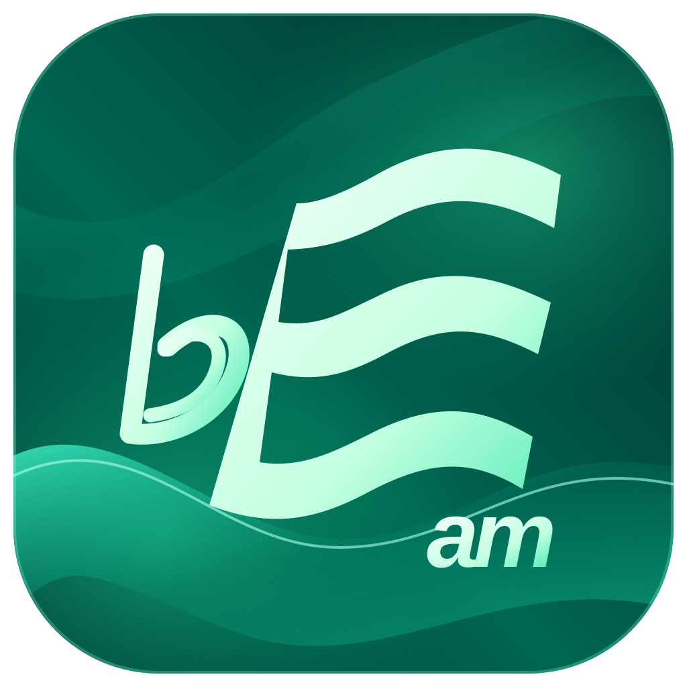

# BEAM Audio



BEAM Audio is an open-source **Erlang/OTP runtime for synchronized network audio and cooperative processing**. Independent Devices can publish and subscribe to live sound, voluntarily offer their speakers, microphones and computing resources, and gather in temporary **Buffees** (called **Sessions** in user interfaces). Every audio packet carries its own sender-assigned **Presentation Target** on a shared clock, allowing receivers to schedule playback independently for the same intended moment.

The aim is to connect anything from a phone and a laptop to dedicated speaker endpoints, multizone sound systems, home cinemas and installations. Distributed DSP, spatial audio and automatic acoustic calibration are longer-term goals; they are not finished features.

## Platforms and compatibility

The Erlang core is portable, but **native audio support and application integration vary by platform**:

- **macOS — active development:** BEAM runtime, headless Device CLI and native Core Audio capture/output adapters. Application integration and physical speaker timing still need validation.
- **Windows — active development:** BEAM runtime, local web control service and WASAPI audio adapters. The existing native wxErlang app still has a legacy compatibility path; end-to-end native audio is not yet qualified.
- **iOS / iPadOS — partial implementation:** Embedded BEAM runtime and Apple audio bindings exist. Current application migration, packaging and on-device playback validation are incomplete; iPadOS is not separately qualified.
- **Linux — core and services:** Erlang/OTP runtime and the Elixir/Phoenix Reception can run on Linux. A maintained Linux capture/playback adapter and complete Device packaging are not yet provided.
- **Raspberry Pi / ARM Linux — intended target:** Suitable for standalone speakers and processors once Linux audio adapters and deployment packaging are available.
- **Android — planned:** No Android Device app or native audio adapter yet.
- **Web browsers — control interface:** The optional Device Web service exposes a local Device through a browser-based frontend. The browser is not itself a BEAM Audio playback engine.
- **Other OTP-capable systems — potential:** BSD and other compatible hosts may run parts of the Erlang stack, but have no project-specific audio integration.
- **Bare metal — experimental possibility:** Standard Erlang/OTP expects operating-system services. Running the system without a conventional OS would require a suitable BEAM/OTP port, networking and audio drivers; this is not supported today.

## How it works

**Erlang/OTP** manages Device lifecycles, permissions, subscriptions, Jobs and the shared playback timeline. **Reception** introduces Devices and relays authenticated control messages without owning their Buffees. Replaceable **Stream Handlers** carry PCM or Opus audio over WebRTC; local **Audio Engines** and platform adapters handle decoding, buffering and hardware output. Devices retain control over their own resources.

The system is designed for IP networks, from local networks to the internet. Reception and WebRTC help with discovery and connectivity, but firewalls, NAT policies and network conditions can still prevent a connection.

## Project status and getting started

The headless control and audio paths have automated checks, including scheduled PCM/Opus handling. **Physical speaker alignment, uninterrupted playback and full cross-platform interoperability are not yet established.** This is a developing runtime, not a finished consumer audio product.

```sh
rebar3 compile
```

See [building and platform setup](docs/BUILDING.md), [headless Device CLI](src/Tools/CLI/README.md), [local Device Web service](src/Services/DeviceWeb/README.md), and [audio architecture](src/Audio/README.md). For the current design and progress, see [terminology](docs/TERMINOLOGY.md), [development plan](docs/PLAN.md) and [validation record](docs/PROGRESS.md).

The separately developed **OpenSound App** is the commercial user interface built on this open-source core. BEAM Audio can be built and used without it.

Licensed under [Apache 2.0](LICENSE); third-party components retain their own notices.
