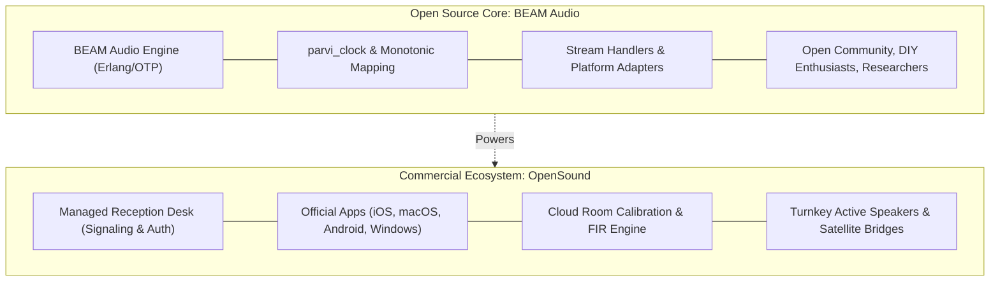

# OpenSound & BEAM Audio — Business Model & Product Strategy

## 1. Executive Summary & Brand Architecture

OpenSound operates on an **Open-Core & Hardware Ecosystem** model, decoupling the open-source transport plumbing from the commercial applications, cloud infrastructure, and turnkey hardware.



- **BEAM Audio (Open Source Engine)**: 
  - Licensed under permissive open source (Apache 2.0 / MIT).
  - Includes cluster distribution, nanosecond clock synchronization, replaceable audio stream handlers, and native platform adapters.
  - Ensures transparency, auditability, and organic developer adoption across Linux, Raspberry Pi, macOS, Windows, and Android.
- **OpenSound (Commercial Consumer & Pro Brand)**: 
  - Owns the polished native client applications in Apple App Store and Google Play Store.
  - Operates the high-availability cloud signaling infrastructure (Reception Desk).
  - Sells cloud acoustic room tuning services, multi-room venue software, and turnkey pre-configured active speaker hardware.

---

## 2. Software Subscription Tiers

Subscriptions are billed per **OpenSound Cloud Account** (not micro-charged per device, avoiding App Store transaction fee traps and Apple ID family-sharing restrictions).

| Tier | Price | Capacity | Key Features | Target Audience |
| :--- | :--- | :--- | :--- | :--- |
| **Free Tier** | **€0** | 2 Nodes (Host)<br>Unlimited (Guest) | Local Wi-Fi discovery, basic self-hosting, join any paid cluster indefinitely. 45-minute hosting session limit on >2 nodes. | Adoption, trial, party guests, DIY hackers. |
| **Cinema Home** | **€4.99 / mo** | Up to **64 Nodes** | Unlimited cluster sessions, cloud calibration sweeps, universal streaming ingest, unlimited cloud relay bandwidth. | Home cinemas (7.1.4 to 22.2), whole-house audio, private parties. |
| **Pro / Venue** | **€19.99 / mo** | **Unlimited Nodes** | Multi-zone matrix router, virtual mixer console, priority cloud relay, redundant network failover, commercial licensing. | Clubs, bars, theaters, festival stages, churches, wedding DJs. |

### 2.1 The Free Tier: "Zoom Viral Guest" Model
- **Guests Are Always Free**: A user with a free account can be invited to any cluster (such as a 20-speaker home cinema or a 10,000-person public event) and stream audio indefinitely without paying.
- **Viral Adoption Engine**: Guests at an event download the free app, pair via QR code, and experience zero friction.
- **Host Limitations**: If a free account hosts a cluster with more than 2 speakers, a **45-minute continuous session timeout** applies. To host permanent multi-speaker setups, the host upgrades to Cinema Home.

### 2.2 Cinema Home Tier (€4.99 / month)
- **64-Node Headroom**: Sufficient for an advanced 9.1.6 Dolby Atmos setup plus multi-room speakers across patio, living room, and bedrooms.
- **Single-Device Multi-Channel Rule**: A single device (such as an iPhone or Mac plugged into an existing 5.1/7.1 AV receiver or multi-channel USB DAC) counts as **one single node**. Users are never penalized for owning multi-channel hardware.
- **Cloud Acoustic Calibration**: Automatically deconvolves logarithmic sine sweeps recorded by phone microphones, calculates room modes, and computes bespoke FIR phase-inversion filters pushed directly to speaker nodes.
- **Universal Media Ingest (No Illegal Rebroadcasting)**:
  - *System Audio Tap*: Uses OpenSound’s process tap (`parvi_audio_input`) on Mac/PC to capture system audio from any video player or browser.
  - *Integrated Cast Receivers*: Embeds open-source receiver daemons (such as AirPlay and Spotify Connect) on the master node so users can cast directly from phones.

### 2.3 Pro / Venue Tier (€19.99 / month)
- **Multi-Zone Matrix Routing**: Independently route multiple inputs (DJ deck, live mics, background music) to isolated zones (Dancefloor, Lounge, VIP, Restrooms).
- **Virtual Mixer & DSP Patchbay**: Web- and tablet-based mixing console with channel faders, mutes, master delay compensation, and live peak limiter telemetry.
- **Priority Infrastructure & Failover**: SLA-backed signaling relay with redundant fallback channels over secondary Wi-Fi/LTE connections.
- **Disruptive Pricing**: Replaces enterprise Dante/Q-SYS matrix processors that cost upwards of €3,000 to purchase and configure.

---

## 3. Turnkey Hardware Product Strategy

Software subscriptions provide high-margin recurring revenue, but hardware sales generate **immediate cash flow and rapid market adoption**. High-end audio enthusiasts prefer buying working hardware over flashing SD cards.

```
       [ Front: Acoustic Driver ]
  +-----------------------------------+
  |                                   |
  |           ACTIVE SPEAKER          |
  |              CABINET              |
  |                                   |
  +-----------------------------------+
       [ Back: Maintenance Panel ]
  +-----------------------------------+
  |  +-----------------------------+  |
  |  |  INTEGRATED STATUS DISPLAY   |  |  <--- Shows: Node ID, IP, Role
  |  |  [ QR Code ]   Role: Surr L |  |       ("Surround Left"), VU Meter,
  |  |  Clock: Sync   Offset: 0.1ms|  |       and Pairing Controls
  |  +-----------------------------+  |
  |                                   |
  |  [ XLR / TRS ]  [ AC Power ]      |
  +-----------------------------------+
```

### 3.1 Smart Active Speakers (Pre-Configured BEAM Audio Units)
- **Concept**: Professional active studio monitors / cinema surround speakers with built-in compute boards running embedded BEAM Audio out of the box.
- **Rear Maintenance Screen**:
  - A low-cost integrated touchscreen or repurposed mobile display mounted on the rear of the speaker cabinet.
  - **Self-Configuring Maintenance UI**: Displays live cluster status, connection health, cluster pairing QR code, assigned spatial role (e.g. `Surround Left`, `Height Rear Right`), and acoustic calibration VU meters.
  - Allows technicians and venue staff to diagnose signal loss or reassign speaker roles physically at the speaker cabinet without opening a laptop.
- **Zero-Touch Setup**: Powered on, the speaker connects via local Wi-Fi/Ethernet, discovers the cluster authority via mDNS, accepts signed trust credentials, and is immediately ready for calibration.

### 3.2 Standalone Speaker Bridge ("OpenSound Satellite Box")
- **Product**: Compact, fanless aluminum bridge box containing a compute unit (e.g. Raspberry Pi CM4 or Rockchip RK3588) paired with a high-performance I2S DAC (balanced XLR / 1/4" TRS outputs).
- **Purpose**: Converts existing high-end active studio monitors (Genelec, Adam Audio, Yamaha HS, KRK) into wireless, synchronized OpenSound cluster nodes.
- **Price Point**: €149–€249 per unit with high hardware gross margins (40–50%).

---

## 4. Competitive Positioning

| Feature | Audinate Dante | RAVENNA / AES67 | Sonos / Apple AirPlay | OpenSound & BEAM Audio |
| :--- | :--- | :--- | :--- | :--- |
| **Network Requirement** | Dedicated Gigabit Ethernet + PTP switches | PTP-aware network infrastructure | Standard Wi-Fi | **Standard Wi-Fi + Ethernet (Zero switch requirements)** |
| **Hardware Compatibility** | Proprietary Dante chips only | Commercial broadcast cards / FPGAs | Walled garden (Sonos / Apple only) | **Heterogeneous (Raspberry Pi, Android, Mac, PC, iOS)** |
| **Spatial / Object Audio** | Channel-based routing only | Channel-based routing only | Proprietary Atmos (Sonos Arc only) | **Decentralized 3D VBAP & Ambisonic Edge Rendering** |
| **Cost to User** | €1,000s in hardware + €50–€150/seat software | Commercial broadcast pricing | €500–€1,000 per speaker box | **Free open-source core + €4.99/mo cinema tier** |
| **DIY & Customization** | Completely closed | Open standard, closed implementations | Completely closed | **100% Open source engine + extensible NIFs** |

