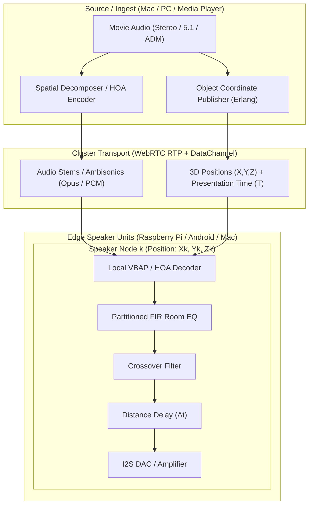

# OpenSound Cinema & Surround Systems Architecture

> **Archived 2026-11-08 — historical proposal or checkpoint.**
> Preserved for reference; statements such as “current”, “next”, and
> “accepted” below describe their original date. They do not set today’s
> implementation order or establish working features. Follow the
> [secure Swarm roadmap](../PLAN.md) and [archive notes](README.md).

> **Status — 2026-11-02:** Long-term vision, not an implementation or validation
> report. Follow [PLAN.md](PLAN-before-swarm-2026-11-08.md#previous-priorities--revised-2026-11-02) for the
> active order: audio quality/reliability and scheduled output, virtual/real
> discrete multichannel cinema, public/private split, then DSP. Numerical latency,
> scale, clock-accuracy and glitch-free claims below are hypotheses to verify,
> not current guarantees. Format/decoder access, video delay control and distributed
> configuration rollback also require separate implementation/evidence. Begin with
> known discrete channel fixtures; HOA, object rendering and room-correction DSP
> do not gate the first working cinema configuration.

## 1. Vision & Paradigm Shift

Traditional cinema processors and AV receivers (AVRs)—such as Trinnov, StormAudio, or high-end Dolby Atmos processors—rely on a **monolithic, centralized DSP engine**. A single chassis decodes 16–32 channels, computes room correction FIR filters, applies crossovers, and runs digital-to-analog converters (DACs) over analog copper cables with strict <5 ms buffer deadlines.

OpenSound inverts this paradigm into a **Distributed Edge-DSP Cinema**:
- **Heterogeneous Hardware**: 6 to 20+ active speakers, each connected to its own inexpensive compute unit (Raspberry Pi with I2S DAC, Android device, mini PC, or Mac).
- **Aggregate Compute Power**: A 10-node cluster possesses 10× the memory and CPU of a single embedded DSP chip, enabling higher-order FIR convolution and room correction.
- **The Presentation Delay Advantage**: Video playback naturally accommodates lip-sync delays (e.g. 50–150 ms global delay budget). This eliminates ultra-low-latency buffer starvation risks and allows asynchronous, distributed processing across the cluster.
- **Edge Rendering**: The central source broadcasts the 3D acoustic scene or ambisonic soundfield; each speaker renders its own contribution locally.

---

## 2. Existing OpenSound Foundations

OpenSound already defines core spatial and timing contracts that support this cinema architecture:

1. **Spatial Profile Contract ([`docs/AUDIO_STREAM_CONTRACT.md`](../AUDIO_STREAM_CONTRACT.md))**:
   - Defines the `point` profile: 3D Cartesian coordinates $(X, Y, Z)$ per audio object with explicit coordinate frames and time units.
   - Defines **spatial selection spheres** and separation of **spatial filtering** from **spatial rendering**.
   - Establishes that receiving the full scene and filtering/rendering locally at the edge is a first-class architectural pattern.
2. **Native Backend Boundary ([`docs/BEAM_Audio_Codex_Implementation_Spec.md`](BEAM_Audio_Codex_Implementation_Spec.md))**:
   - Separates channel mapping from point metadata rendering.
   - Preserves platform independence by avoiding hardcoded proprietary DSP inside the Erlang BEAM layer, offloading sample convolution to native SIMD engines.
3. **Cluster Clock Domain ([`docs/PLAN.md`](../PLAN.md) & `parvi_clock`)**:
   - Provides nanosecond-level cluster clock mapping and slew correction.
   - Sets the target for multi-channel acoustic measurement using simultaneous impulse/correlation capture.

---

## 3. The Three Cinema Processing Pillars



### 3.1 Object Audio: Decentralized Rendering (Atmos / DTS / Open Formats)

#### The Licensing Reality
Proprietary bitstreams (Dolby Atmos, DTS:X, Auro-3D) require closed, licensed decoders. OpenSound cannot legally bundle proprietary decoders onto open-source Raspberry Pi or DIY nodes without royalties.

#### The Open Solution
1. **Source-Side Decoding**: An authorized consumer player (e.g. Apple TV, Mac with spatial audio, or PC running Dolby Access) decodes the proprietary stream into discrete uncompressed multi-channel LPCM or open **ADM (Audio Definition Model, ITU-R BS.2076)** / **IAMF (Immersive Audio Model and Formats)** stems.
2. **Broadcasting the Scene**: The source broadcasts $N$ audio stems along with lightweight Cartesian coordinate metadata $(x, y, z, \text{spread})$ over WebRTC.
3. **Decentralized VBAP (Vector Base Amplitude Panning)**:
   - Each speaker node knows its calibrated 3D room coordinates $(x_k, y_k, z_k)$.
   - Each speaker independently calculates its panning gain for every object:
     $$g_k(t) = \text{VBAP3D}(\text{Object}_{xyz}(t), \text{Speaker}_{k, xyz})$$
   - The speaker multiplies each incoming stem by $g_k(t)$ and sums them locally.
   - **Result**: Network bandwidth and source CPU are independent of speaker count (whether 6, 16, or 32 speakers).

---

### 3.2 Stereo & 5.1 Upmixing: Higher-Order Ambisonics (HOA)

To project legacy stereo or 5.1 soundtracks onto 10–20 speakers without a rigid channel matrix:

1. **Frequency-Domain Spatial Decomposition**:
   - The central source splits the stereo signal using **Directional Ambience Extraction (PCA / Blind Source Separation)**.
   - Center/dialogue energy is isolated into direct frontal vectors.
   - Decorrelated reverberant energy is extracted into diffuse 3D surround envelopment.
2. **Ambisonic Encoding**:
   - The soundfield is encoded into **Higher-Order Ambisonics (HOA)** (e.g. 3rd-Order HOA = 16 spherical harmonic channels).
   - Ambisonics describes the soundfield at the listening sweet spot independently of any physical speaker positions.
3. **Decentralized HOA Decoding**:
   - Every physical speaker node stores a single precomputed 16-element decoding vector corresponding to its direction $(\theta_k, \phi_k)$ and distance $r_k$:
     $$s_k(t) = \sum_{m=0}^{15} D_{k, m} \cdot B_m(t)$$
   - Each speaker performs an instantaneous vector dot product on the incoming Ambisonic stream. Adding or moving a speaker requires zero changes to the central upmixer.

---

### 3.3 Calibration: Distributed Math & Local FIR Correction

Cinema calibration addresses three acoustic distortions: speaker frequency response anomalies, room mode resonances, and physical distance delays.

#### Phase 1: Asynchronous Measurement & Distributed FFT Deconvolution
1. The user places a measurement microphone (or smartphone) at the primary listening position (sweet spot).
2. The Erlang authority plays a synchronized logarithmic sine sweep sequentially through each speaker (Speaker 1 through $N$).
3. The raw microphone recordings are captured and distributed across the cluster:
   - Node A computes deconvolution for Front L/C/R.
   - Node B computes deconvolution for Surrounds and Ceilings.
   - Node C calculates room modes and target curve inversion (linear-phase or minimum-phase).

#### Phase 2: Local Edge Filter Execution
Once computed, each speaker receives its own personalized DSP profile:
1. **Time Alignment**:
   $$\Delta t_k = \frac{d_{\text{max}} - d_k}{c_{\text{sound}}}$$
   Where $d_k$ is the distance from speaker $k$ to the sweet spot, and $c_{\text{sound}} \approx 343 \text{ m/s}$. The speaker buffers incoming audio by $\Delta t_k$ to achieve sub-millisecond wavefront arrival alignment.
2. **Room EQ (FIR Convolution)**:
   - The speaker runs a high-resolution FIR filter (e.g. 4096 to 16384 taps) via an optimized native engine (e.g. CamillaDSP or Apple Accelerate) to correct room modes below 300 Hz and smooth high frequencies.
3. **Crossover & Driver Linearization**:
   - If a speaker node drives multiple internal drivers (e.g. bi-amped woofer + tweeter via a multi-channel I2S DAC), the node computes the crossover filters locally.

---

## 4. Hardware Node Configuration Matrix

| Role | Typical Hardware | Audio I/O | DSP Responsibility |
| :--- | :--- | :--- | :--- |
| **Cluster Authority / Source** | Mac Mini / PC / Linux Server | HDMI / Process Tap / USB Interface | Video playback, spatial scene generation, HOA encoding, clock master. |
| **Front L / C / R Speakers** | Raspberry Pi 4/5 or Mini PC | I2S HiFiBerry DAC / USB DAC (Balanced XLR) | VBAP rendering, high-tap FIR room EQ, dialogue clarity filter. |
| **Surround & Height Speakers** | Raspberry Pi Zero 2W / Android TV Unit | I2S DAC / Stereo 3.5mm Amp | Ambisonic decoding, delay alignment, basic biquad PEQ. |
| **Subwoofer(s)** | Raspberry Pi with DAC | Low-pass filtered Line Out | Multi-subwoofer optimization (MSO), room mode notch filters, phase alignment. |
| **Measurement Tool** | iPhone / iPad / USB Calibrated Mic | Built-in mic or USB UMIK-1 | Sweep recording, interactive room geometry configuration. |

---

## 5. DSP Pipeline Latency & Video Lip-Sync

In traditional live monitoring, latency must be $<5 \text{ ms}$. In a home cinema, latency is irrelevant as long as it is **constant, predictable, and compensated by video delay**:

```
[ Video Player ] --------------------> Video Delay Buffer (100 ms) ------> Display / Projector
       |
       v
[ Audio Ingest ]
       |
       +--> HOA Upmix / Object Packaging (~15 ms)
       +--> WebRTC Network Transmission (~10 ms)
       +--> Edge VBAP Panning (~2 ms)
       +--> Edge FIR Convolution (~10 ms)
       +--> Output Buffer & DAC Latency (~20 ms)
       |
       v
[ Acoustic Output ] -----------------> Arrives at ear at exactly T + 100 ms
```

- **Global Delay Target**: Set a system-wide presentation target of $\Delta_{\text{cinema}} \approx 100 \text{ ms}$.
- **Video Sync**: Video players (such as VLC, Infuse, Kodi, or MPV) are configured with an audio delay of $+100 \text{ ms}$ (or video delay of $+100 \text{ ms}$), achieving perfect acoustic lip-sync.
- **Jitter Absorption**: The 100 ms budget allows the WebRTC NetEq jitter buffers on every node to operate at optimal stability with zero packet drops or concealment glitches.

---

## 6. Implementation Milestones

1. **Multi-Channel Speaker Registry (Erlang Control)**:
   - Extend `parvi_cluster_trust` / store with speaker metadata: physical coordinates $(x, y, z)$, speaker role (`front_left`, `subwoofer`, `ceiling_rear_right`), and FIR profile IDs.
2. **Ambisonic Stream Profile**:
   - Implement the B-format / HOA descriptor binding in `parvi_audio_source` according to [`docs/AUDIO_STREAM_CONTRACT.md`](../AUDIO_STREAM_CONTRACT.md).
3. **Local Edge DSP Integration**:
   - Integrate an embedded convolution engine (e.g. CamillaDSP backend or native C/Rust NIF) into the edge speaker adapter.
4. **Calibration Wizard**:
   - Build the automated sweep generation and deconvolution worker pool in Erlang to generate FIR filters directly from phone mic recordings.

---

## 7. Configuration History & Snapshot-Based Undo / Redo

Because OpenSound already represents cluster state as immutable terms and checkpoints complete node snapshots upon closure and state changes (`parvi_cluster_store`, `parvi_native_bridge:snapshot/0`, and `parvi_node_diagnostics`), implementing a comprehensive **Undo / Redo system** is direct and natural:

1. **Snapshot Stack & Ring Buffer**:
   - Every mutating user action (e.g. modifying speaker 3D coordinates, updating an EQ/crossover curve, adjusting delay offsets, reassigning speaker roles, or altering channel routing) pushes the previous immutable snapshot onto an in-memory `UndoStack`.
2. **Instant State Rollback (`undo` / `redo`)**:
   - Triggering `undo` pops the previous snapshot from the stack and applies it across the cluster via OTP supervision calls, pushing the superseded state to a `RedoStack`.
3. **Persistent Session Recovery**:
   - By storing a rolling history of the last $N$ checkpoints in `parvi_cluster_store`, users can roll back configuration mistakes across application restarts (e.g. *"Revert room calibration to yesterday's sweep"* or *"Restore previous surround layout"*).

