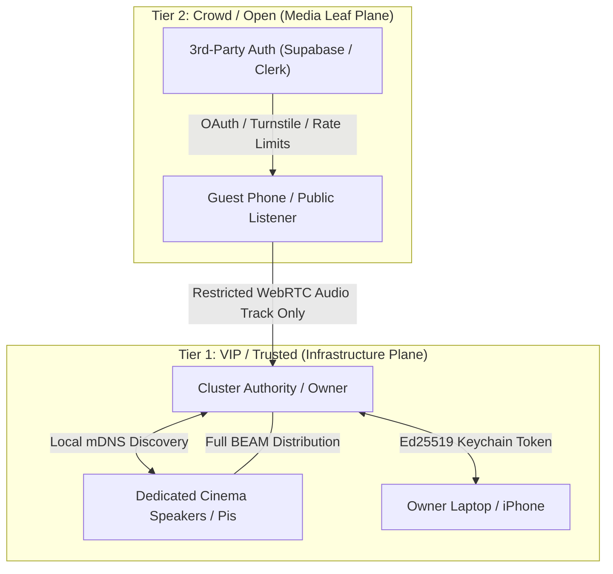

# OpenSound Risk Management & Security Architecture

> **Archived 2026-11-08 — historical proposal or checkpoint.**
> Preserved for reference; statements such as “current”, “next”, and
> “accepted” below describe their original date. They do not set today’s
> implementation order or establish working features. Follow the
> [secure Swarm roadmap](../PLAN.md) and [archive notes](README.md).

## 1. Executive Summary

OpenSound (Parvi) is an open, distributed audio-over-IP platform combining Erlang/OTP cluster control with native media engines (WebRTC/Opus). As the system transitions from lab prototypes (Mac-to-iPhone) to real-world deployment across home cinemas, shared listening sessions, and mass public events, it encounters distinct threat vectors:
- **Distributed System Security**: Erlang node distribution inherently grants full remote code execution (RCE) and must never be exposed to untrusted peers.
- **Privacy & Espionage**: Unrestricted remote microphone access poses serious privacy and wiretapping risks.
- **Acoustic & Hardware Safety**: Uncapped audio inputs can destroy physical speaker drivers or cause hearing damage.
- **Legal & Copyright Liability**: Uncontrolled retransmission of commercial media can incur contributory copyright infringement and DMCA liability for signaling operators.
- **Scalability Limits**: Mesh signaling collapses beyond small groups ($O(N^2)$ complexity).

This document establishes the threat model and defines a **Two-Tier Architecture (VIP Tier vs. Crowd Tier)** to solve these challenges.

---

## 2. Threat Analysis & Vulnerabilities

### 2.1 Erlang Node Distribution Exposure (Critical Severity)
- **Vulnerability**: Standard Erlang/OTP distribution (`net_kernel`, `epmd`, `parvi_webrtc_dist`) operates on total mutual trust. Once an untrusted node is admitted to the BEAM cluster, it can execute arbitrary Erlang functions or OS shell commands on all other nodes (`erpc:call/4`, `rpc:call/4`, `os:cmd/1`).
- **Impact**: Any guest joining an open cluster could access local files, spawn rogue processes, silently trigger microphone recording, or crash the runtime.
- **Mitigation**: **Untrusted guests and audience devices must never join the BEAM distribution mesh.** They must interact solely as sandboxed clients over restricted media and signaling protocols.

### 2.2 Microphone Espionage & Unauthorized Wiretapping
- **Vulnerability**: Features requiring microphone access (such as room acoustic calibration) could be abused by malicious cluster members to secretly capture ambient room audio.
- **Impact**: Violation of wiretapping laws, privacy breaches, and loss of user trust.
- **Mitigation**:
  1. Microphones must never be activated purely via network commands.
  2. Calibration requires explicit, physical on-device user confirmation via OS-level prompts.
  3. Strict, hardcoded session timeouts (e.g. max 30 seconds of test-tone measurement) and visual active-recording indicators.

### 2.3 Acoustic Shock & Physical Driver Damage
- **Vulnerability**: A rogue participant streaming 0 dBFS full-scale square waves, high-gain ultrasonic signals, or low-frequency transients.
- **Impact**: Blown tweeters/subwoofers in high-end cinema setups; permanent acoustic trauma to human listeners.
- **Mitigation**:
  1. Hard-coded native peak limiters, RMS ceilings, and DC-offset filters in platform output adapters (`IOSAudioOutput.swift`, ALSA, Core Audio).
  2. Network volume or gain commands must be clamped locally and cannot override native safety thresholds.

### 2.4 Copyright Infringement & Service Operator Liability
- **Vulnerability**: Users sharing commercial audiovisual media (Blu-ray, DVD, streaming services, pay-per-view) across WAN to unauthorized audiences.
- **Legal Context**:
  - *Software vs. Service*: Distributing open-source software with substantial non-infringing uses is protected under the *Sony Betamax* doctrine.
  - *Signaling Operator Liability*: Operators hosting the central rendezvous/signaling service (e.g. the Render-hosted Reception Desk or BitTorrent trackers) are subject to contributory copyright infringement claims (e.g. *MGM v. Grokster*) if they fail to address infringing swarms or lack Safe Harbor (DMCA §512 / EU Copyright Directive) compliance.
  - *DRM Circumvention*: Decrypting protected media (AACS on Blu-ray, CSS on DVD, HDCP on HDMI) to capture audio violates anti-circumvention laws (DMCA §1201).
- **Mitigation**: Hard subscriber quotas on personal swarms, non-transferable invitations, and decentralization of signaling.

### 2.5 Scalability & Clock Synchronization Exhaustion
- **Vulnerability**: 10,000 public audience members performing 30-second SNTP or `erpc` clock pulls directly against a master node.
- **Impact**: Complete denial of service (DoS) of the master node and collapse of WebRTC mesh coordination ($O(N^2)$ signaling messages).
- **Mitigation**: Passive, unidirectional broadcast trees for large crowds; listeners calculate offsets from broadcast timeline anchors without querying the master.

---

## 3. Scenario Evaluations

| Scenario | Primary Threats | Architectural Requirements |
| :--- | :--- | :--- |
| **1. Group Jam** (4 BT speakers, 10 phones, shared outputs, acoustic calibration) | Input contention, audio hijacking, malicious calibration recording, blown speakers. | - Token-based DJ queue in `parvi_audio_source`. - On-device physical prompt for calibration mic. - Native output peak limiters. |
| **2. 20-Speaker Cinema & Remote Watch Party** (Multi-speaker heterogeneous surround, remote sync watching) | Proprietary format licensing (Atmos/DTS), DRM circumvention, unauthorized WAN retransmission. | - Source-side spatial decoding (LPCM/Ambisonics) mapped to discrete speaker nodes. - Sync metadata transmission rather than rebroadcasting encrypted video bitstreams. |
| **3. 10,000-Node Crowd Event** (Park flash mob, public playback) | Mesh collapse ($O(N^2)$), clock master DoS, public performance licensing, noise regulations. | - Hierarchical broadcast tree (Source $\to$ Relays $\to$ Listeners). - Passive unidirectional clock sync. - Public performance licensing (ASCAP/BMI/Teosto). |

---

## 4. The Two-Tier Trust Architecture

To resolve the tension between open viral scalability and rigorous system security, OpenSound defines two strictly separated operational tiers:

### 4.1 Tier 1: VIP / Trusted (Infrastructure Plane)
- **Scope**: Home cinema processors, dedicated Raspberry Pi/Android speaker units, sound engineer consoles, and verified admin devices.
- **Discovery**: Zero-cloud autonomous discovery via local network broadcast (**mDNS / DNS-SD** or UDP multicast beacon). Operates completely offline without internet access.
- **Authentication**: Mutual **Ed25519** public-key verification.
- **Privilege Level**: **Full Erlang Distribution**. Nodes participate in cluster supervision, routing, clock master election, and cluster-wide diagnostics.
- **Persistence**: Upon admission, the cluster authority signs the node's public key. The certificate is stored in platform secure storage (Keychain / encrypted disk store) allowing authorized remote reconnection over WAN without re-pairing.
- **Revocation**: The authority can invalidate a node's certificate in `parvi_cluster_store`, severing BEAM distribution (`erlang:disconnect_node/1`) and blocking future connections at the carrier layer.

### 4.2 Tier 2: Crowd / Open (Media Leaf Plane)
- **Scope**: Casual party guests, venue attendees, viral links, and public audience members.
- **Admission**: Reusable or forwardable invitation links mediated by a managed identity layer.
- **Anti-Sybil & Account Control**:
  - Managed by a third-party authentication provider (e.g. Supabase Auth, Clerk, or Firebase Auth).
  - Enforces bot protection (Cloudflare Turnstile), verified logins (Apple/Google OAuth or SMS phone verification), and hourly connection rate-limiting to prevent disposable bot swarms.
- **Privilege Level**: **Strictly Sandboxed Audio Leaf**.
  - **No Erlang Node Distribution**: Crowd nodes never connect to the BEAM mesh.
  - **Media-Only Track**: They receive an Opus RTP audio track via `parvi_webrtc_audio_session` in receive-only mode.
  - **No Command Execution**: They cannot run RPC calls, query cluster state, access microphones, or manipulate routing matrices.
- **Capacity Controls**: Managed signaling sets hard swarm participant limits (e.g. max 16 peers for free/unverified rooms).

---

## 5. Implementation Roadmap

1. **Local mDNS Discovery for VIPs**:
   - Implement local multicast discovery in Erlang so VIP nodes find the cluster authority without the cloud Reception Desk.
2. **Strict Carrier-Level Handshake Gate**:
   - Update `parvi_webrtc_dist` to verify that an incoming connection holds a valid, non-revoked VIP certificate before initiating the BEAM distribution handshake.
3. **Restricted Leaf Stream Handler**:
   - Formalize the "Leaf Mode" in `parvi_webrtc_audio_session` for crowd listeners, ensuring no distribution channels are attached.
4. **Native Output Audio Clamps**:
   - Verify that all platform output adapters (`IOSAudioOutput.swift`, Mac helper, Windows audio) enforce native peak limiters regardless of incoming sample amplitudes or network volume commands.
5. **Physical Mic Opt-In**:
   - Require explicit on-device modal confirmation and audio recording permission checks before executing any acoustic calibration sweep.

